  
  

**Currently seeking:** research assistant and research internship roles in computational biology and biomedical machine learning (remote or onsite).

## About

Final-year B.Tech Biotechnology student at GITAM, Visakhapatnam, working at the meeting point of **bioinformatics, clinical machine learning and molecular diagnostics**. Research intern at CSIR-CGCRI on hemostatic biomaterials. I build tools that take a biological question from raw data to something you can explore and test.

## Featured work
| [**pmos-companion**](https://github.com/vajrapuharshitha/pmos-companion) | Explainable PMOS (formerly PCOS) screening aid: criteria checker, leakage-aware ML and lifestyle guide. Screening only, not diagnosis. [Live demo](https://vajrapuharshitha.github.io/pmos-companion/) | Python, Streamlit, JavaScript |
| Project | What it does | Stack |
|---|---|---|
| [**biomarker-risk-pipeline**](https://github.com/vajrapuharshitha/biomarker-risk-pipeline) | ML pipeline that ranks biomarkers and classifies tumour risk on the Wisconsin breast cancer data, with an interactive 3D explorer. [Live demo](https://vajrapuharshitha.github.io/biomarker-risk-pipeline/) | Python, scikit-learn, JavaScript |
| [**primer-design-automation**](https://github.com/vajrapuharshitha/primer-design-automation) | Designs PCR primers with Primer3 and screens them for Tm, GC content, hairpins, dimers and binding uniqueness. | Python, Primer3 |
| [**AI-PCOS-Risk-Prediction**](https://github.com/vajrapuharshitha/AI-PCOS-Risk-Prediction) | AI-assisted, biomarker-based PCOS risk prediction system. | Python |
| [**bioinformatics-**](https://github.com/vajrapuharshitha/bioinformatics-) | Bioinformatics coursework and experiments. | Python |
| [**chatbot**](https://github.com/vajrapuharshitha/chatbot) | Conversational assistant project. | Python |

## In progress

- **ONCOGENIX**: an educational 3D platform for learning NGS cancer diagnostics, with a live ML lab. Every result is labelled as real data, curated or simulated.
- **DxForge**: a CRISPR-Cas12a diagnostic assay designer that ranks guides, designs RPA primers and simulates the assay run.

*Educational and portfolio projects. None is a clinical diagnostic tool.*

## Tools

## Get in touch

Open to bioinformatics, computational biology and clinical data roles. Find me on [LinkedIn](https://www.linkedin.com/in/vajrapu).
